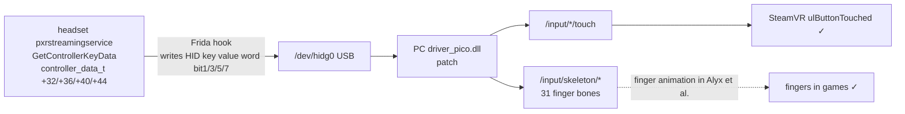

# PICO Neo 3 Pro · Capacitive Touch Fix for Controllers on DP Direct Link

[简体中文](README.md) · **English**

> With a DP cable, the controllers' capacitive touch stops working in SteamVR; this tool brings it back.

[Introduction & tutorial video (bilibili, in Chinese)](https://www.bilibili.com/video/BV1kjpA6BEwB)

## What you will see

- The controllers' **buttons, sticks and triggers all work**;
- but resting a finger **lightly** on A/B/X/Y, a trigger or a stick top does nothing in SteamVR;
- switch to wireless streaming and everything is fine again.

## After the fix

All six touch spots work: A/B/X/Y, the triggers and the stick tops; the **fingers** in games move along too (they animate as soon as you rest a finger down).

- The headset side only patches memory, so it is **lost on reboot** ⇒ run it once per boot;
- The PC side only patches a few files the driver ships with, and can be reverted in one step.

## What else the patch fixes

Besides the touch bits, the driver patch also repairs a few things the vendor shipped broken, and fills in one piece of data the DP build never exposed (it only touches files the driver ships, with automatic backups; details in [`docs/notes/04-driver.md`](docs/notes/04-driver.md)):

- **The menu button does nothing in SteamVR** — the input profile declares `/input/application_menu` without a leading slash, so SteamVR ignores it;
- an angle typo in the controller model's `tip` component (only the DP build has it);
- the driver **fails to load the headset profile and logs an error on every start** — the vendor never shipped `pico_hmd_profile.json`;
- **finger animation in games** — `/pose/raw` and `/skeleton/*` are filled in, which is what games such as Alyx need for the fingers to move;
- **controller models sitting ~4 cm off (and slightly tilted) in games** — the streaming app tells the driver that a game started via an `apprun` message, and the driver adds a pose offset on top of it; the patch makes the driver ignore that message, so the in-game controller pose matches the SteamVR menu / standby one.
- **the virtual hand not sitting in the controller / the arm not straightening** — the driver reports the controller pose near the tracking ring, so a virtual hand grabbing at that same pose ends up ~4 cm below the grip; the patch moves the pose to the grip point and compensates the model vertices in the opposite direction, so the hand lands on the grip while the controller model stays aligned with the real one.

## Requirements

| Item        | Requirement                                                                                       |
| ----------- | ------------------------------------------------------------------------------------------------- |
| Headset     | **Neo 3 Pro / Pro Eye** (DP direct link only exists on this series; a plain Neo 3 has no DP port) |
| Headset OS  | PUI **5.9.9** (build `202409100313`)                                                              |
| PC software | **Chinese edition 1.2.11** of Business Streaming (DP mode)                                        |
| Connection  | **DP direct link** (not wireless streaming)                                                       |

- Only tested on the **Neo 3 Pro**; the **Pro Eye and the international Neo 3 Link are untested**.
- Wireless streaming already works and **does not** need this project; v2.x has no DP mode at all.

## Quick start

### Step 0 · Download

On the GitHub page click **Code → Download ZIP** and unzip it; below, that unzipped folder is simply "the project directory".

Whether adb is installed on the PC does not matter — if it is missing, the scripts download it into `src\windows\temp\` (needs internet).

### 1. Patch the PC driver (one-time)

> Only want A/B/X/Y back and no trigger or stick-top touch? You can skip this step — but then you also lose everything under "What else the patch fixes".

1. **Fully quit** SteamVR, Business Streaming DP and the **Steam client** (Steam holds the driver files open);
2. Double-click `src\windows\patch_driver.bat` and click "Yes" in the UAC prompt.
   The script finds the driver itself, backs it up before writing and verifies the result afterwards; if it cannot find it, it asks you for the path (or pass `-Dll <path>`).

### 2. Every boot: inject into the headset

1. In the headset's **Settings → Developer options**, **turn on adb** ("USB debugging" or "Wireless debugging"; this device needs no authorization, and wireless needs no pairing);
2. Connect the headset: a **USB cable**, or put the headset and the PC on the same network (a PC hotspot is the least hassle). If a cable is plugged in, the cable is used — the script never switches to wireless by itself;
3. Double-click `src\windows\pico_touch.bat` (the window stays open when the script is done; pick a device with `-Serial <serial>`).
   The script does it all: finds the headset → opens the TCP port → gets temporary root → pushes → injects; anything missing is downloaded automatically (needs internet).
   On a USB connection it drops out for a few seconds in the middle (the TCP port is reopened), which is normal;
4. Once you see `[+] 完成` ("done"), you are set — unplug and close the window (the injection runs on the headset itself).

> **Don't want to connect the PC again every boot?** Install **Termux** on the headset, open it once, then run the headset patch script (installed over `adb` from the PC, or sideload the APK on the headset). After that, one line plus Enter in Termux each boot:
>
> ```shell
> dptouch
> ```
>
> Mechanism in [`docs/notes/09-termux.md`](docs/notes/09-termux.md). Only want to push the files, without root or injection? Double-click `src\windows\push.bat`.

## Want headset-side Business Streaming back on 1.2.10?

This project is only verified against headset-side **1.2.10**. With adb connected, double-click `src\windows\downgrade_streaming.bat` to switch back.

If you also want the PC side on that older version, the script first asks whether to download the installer (~211 MB): **fully uninstall the new version in "Apps & features" first, then install it** — do not install over it.

## Verify

SteamVR → Settings → Controllers → **Test Controllers**: rest a finger on A/B/X/Y, the triggers and the stick tops in turn; each one highlighting means it works.

Also take a look at the controllers: the virtual hand should sit right on the grip, and the controller model should stay aligned with the real one.

## Revert / uninstall

| Change                                                               | How to revert                                                                                                                                   |
| -------------------------------------------------------------------- | ----------------------------------------------------------------------------------------------------------------------------------------------- |
| PC driver                                                            | Copy `driver_pico.dll.orig` in the same folder back over `driver_pico.dll`; or reinstall the DP driver                                          |
| The profile, controller model, `RVRPlugin.ini` and HMD-profile fixes | Copy each `*.orig` in the same folder back over the file of the same name (`pico_hmd_profile.json` was created by this script — just delete it) |
| Headset root + injection                                             | gone after a reboot; or run `picohaxx -unroot`                                                                                                  |
| Files pushed to the headset                                          | delete `/data/local/tmp/{frida-inject,hook.js,start_touch.sh}`, `~/pico_touch` and `$PREFIX/bin/dptouch`                                        |

## FAQ

- **Do I have to run it again on every boot?** Yes. Root is temporary (memory only, system partitions untouched) and gone after a reboot.
- **Any risk of bricking the headset?** The headset side only patches memory; the PC side only edits text files the driver ships with plus one DLL, and backs them up automatically.
- **Can I unplug the cable after injection?** Yes. The injection runs locally on the headset.
- **Will it still work after a firmware update?** Not necessarily; it has to be re-adapted, see [`docs/notes/06-root.md`](docs/notes/06-root.md).

## How it works (skippable)

The touch data was always there in the headset's controller service — the DP path simply never read it. The headset hook writes it into the HID reports, and the driver patch both wires the new bits to the trigger and stick-top `/input/*/touch` and derives the 31 finger bones of `/input/skeleton/*` from them (games such as Alyx read the latter for finger animation).



The full reverse-engineering notes are in [`docs/notes/`](docs/notes/) (written in Chinese); dead ends are in [`docs/notes/08-dead-ends.md`](docs/notes/08-dead-ends.md).

## Credits

- [`picohaxx`](https://github.com/264312431/picohaxx) — Qualcomm Adreno/KGSL privilege escalation, the basis for this project's Neo 3 port
- **DeepSeek V4.1 Flash** (a.k.a. 大肥鱼妈妈!) — the model used for the reversing, debugging and documentation of this project throughout

## License

Code and documentation in this repository are released under [WTFPL v2](LICENSE) (Do What The Fuck You Want To Public License). Third-party components involved:

- [`frida`](https://frida.re/) — injection framework
- [`picohaxx`](https://github.com/264312431/picohaxx) — Qualcomm Adreno/KGSL privilege escalation (Neo 3 port)

Each keeps its original license. This project does not distribute PICO's driver DLLs or APKs, but the skeleton code in `src\windows\src\driver_patch\dp_skeleton_payload.bin` was extracted wholesale from the `driver_pico.dll` of PICO's v2 streaming driver — the rights stay with PICO, and it is provided for personal device repair only.

## Disclaimer

This project involves **kernel privilege escalation** and **modifying a vendor driver binary**, and is provided for research and personal device repair only. Judge the risk yourself; the author is not liable for device damage, data loss or a voided warranty caused by using this tool.

[简体中文](README.md) · **English**
