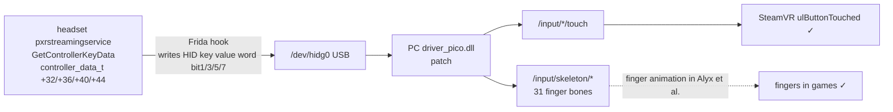

# PICO Neo 3 Pro · Capacitive Touch Fix for Controllers on DP Direct Link

[简体中文](README.md) · **English**

> With a DP cable, the controller touch function does not work in SteamVR. This tool makes the touch function work again.

[Introduction and tutorial video (bilibili, in Chinese)](https://www.bilibili.com/video/BV1kjpA6BEwB)

## What you will see

- The controller buttons, sticks and triggers work.
- If you touch A/B/X/Y, a trigger or a stick top lightly, SteamVR does not respond.
- Wireless streaming works correctly.

## After the fix

All six touch points work: A/B/X/Y, the triggers and the stick tops. When you touch a control, the fingers in games also move.

- The headset side changes memory only. A reboot removes the change. Run the tool again after each reboot.
- The PC side changes only files that the driver supplies. You can revert all changes in one step.

## What else the patch fixes

The driver patch also fixes some problems. It also adds one data output that the DP build does not supply. The patch changes only files that the driver supplies. It makes a backup before each change. For details, refer to [`docs/notes/04-driver.md`](docs/notes/04-driver.md).

- **The menu button does not work in SteamVR.** The input profile declares `/input/application_menu` without a leading slash, so SteamVR ignores this declaration.
- **The `tip` component of the controller model has an incorrect angle.** Only the DP build has this defect.
- **The driver reports a profile load error at each start.** The vendor did not supply the headset profile `pico_hmd_profile.json`.
- **Games do not animate the fingers.** The patch adds `/pose/raw` and `/skeleton/*`. Games such as Alyx read these paths to animate the fingers.
- **In games, the controller models are approximately 4 cm from the correct position and have a small tilt.** When a game starts, the streaming app sends an `apprun` message to the driver. The driver then adds a pose offset. The patch makes the driver ignore this message. The pose in the game then matches the SteamVR menu and standby pose. This 4 cm offset also hid a second defect: the driver reports the pose near the tracking ring. A virtual hand that uses this pose is approximately 4 cm below the grip, and the arm does not straighten. The patch moves the pose to the grip point. It also compensates the model vertices in the opposite direction. The hand then sits on the grip, and the controller model stays aligned with the real controller. The pivots of the moving parts move together with the vertices. Without this step, the trigger and the stick turn about the wrong point. The joystick parameters have a further vendor error: they are written for another axis. The patch moves the joystick pivot and the rotation axes onto the joystick axis, calculated from the model geometry.

## Requirements

| Item        | Requirement                                                                                      |
| ----------- | ------------------------------------------------------------------------------------------------ |
| Headset     | **Neo 3 Pro or Pro Eye**. Only this series has a DP port. A plain Neo 3 does not have a DP port. |
| Headset OS  | PUI **5.9.9** (build `202409100313`)                                                             |
| PC software | **Chinese edition 1.2.11** of Business Streaming (DP mode)                                       |
| Connection  | **DP direct link** (not wireless streaming)                                                      |

- Tests cover the **Neo 3 Pro** only. The **Pro Eye** and the international **Neo 3 Link** are not tested.
- Wireless streaming works correctly and does not need this project. V2.x has no DP mode.

## Quick start

### Step 0 · Download

On the GitHub page, click **Code → Download ZIP**. Unzip the file. In this document, the unzipped folder is "the project directory".

You do not need adb on the PC. If adb is missing, the scripts download it to `src\windows\temp\`. This step needs internet access.

### 1. Patch the PC driver (one time)

> Do you want only A/B/X/Y? Then you can skip this step. If you skip this step, you also lose all items in "What else the patch fixes".

1. **Quit SteamVR, Business Streaming DP and the Steam client.** Steam keeps the driver files open.
2. Double-click `src\windows\patch_driver.bat`. Click **Yes** in the UAC prompt. The script finds the driver, makes a backup, applies the patch and verifies the result. If the script cannot find the driver, it asks you for the path. You can also use the `-Dll <path>` parameter.

### 2. Each boot: inject into the headset

1. In the headset, open **Settings → Developer options**. **Turn on adb** ("USB debugging" or "Wireless debugging"). This device needs no authorization. Wireless adb needs no pairing.
2. Connect the headset. Use a **USB cable**, or connect the headset and the PC to the same network. A PC hotspot is a simple option. If a cable is connected, the script uses the cable. The script does not switch to wireless.
3. Double-click `src\windows\pico_touch.bat`. The window stays open when the script is done. To select a device, use `-Serial <serial>`. The script finds the headset, opens the TCP port, gets temporary root, pushes the files and injects. It downloads missing dependencies automatically. This step needs internet access. On a USB connection, the connection drops for a few seconds. This is normal.
4. Wait for `[+] 完成` ("done"). You can then disconnect the cable and close the window. The injection runs on the headset.

> **Do you want to inject without a PC after each boot?** Install **Termux** on the headset and open it one time. Then run the headset patch script. You can install the script with adb from the PC, or install the APK on the headset. After that, enter this command in Termux at each boot:
>
> ```shell
> dptouch
> ```
>
> For details, refer to [`docs/notes/09-termux.md`](docs/notes/09-termux.md). Do you want to push the files only, without root or injection? Double-click `src\windows\push.bat`.

## Want to downgrade headset-side Business Streaming to 1.2.10?

This project is tested with headset version **1.2.10** only. Connect the headset with adb. Then double-click `src\windows\downgrade_streaming.bat` to change back to 1.2.10.

If you also want to downgrade the PC side, the script asks you to download the installer (approximately 211 MB). Fully uninstall the new version in **Apps & features** first. Then install the older version. Do not install it over the new version.

## Verify

Open SteamVR → Settings → Controllers → **Test Controllers**. Touch A/B/X/Y, the triggers and the stick tops one by one. A highlight shows that the touch point works.

Also look at the controllers. The virtual hand must sit on the grip. The controller model must stay aligned with the real controller.

Then pull the triggers and push the sticks. Each trigger must turn about its own axis. Each stick must turn about its own axis, and the cap must not slide.

## Revert and uninstall

| Change                                                               | How to revert                                                                                                                                |
| -------------------------------------------------------------------- | -------------------------------------------------------------------------------------------------------------------------------------------- |
| PC driver                                                            | Copy `driver_pico.dll.orig` from the same folder over `driver_pico.dll`. Or reinstall the DP driver.                                         |
| The profile, controller model, `RVRPlugin.ini` and HMD profile fixes | Copy each `*.orig` file from the same folder over the file with the same name. The script creates `pico_hmd_profile.json`; delete this file. |
| Headset root and injection                                           | A reboot removes them. You can also run `picohaxx -unroot`.                                                                                  |
| Files that the script pushes to the headset                          | Delete `/data/local/tmp/{frida-inject,hook.js,start_touch.sh}`, `~/pico_touch` and `$PREFIX/bin/dptouch`.                                    |

## FAQ

- **Do I need to run the tool again after each boot?** Yes. Root is temporary. It changes memory only and does not touch the system partitions. A reboot removes it.
- **Can the tool damage the headset permanently?** The headset side changes memory only. The PC side changes text files that the driver supplies and one DLL. The script makes backups automatically.
- **Can I disconnect the cable after the injection?** Yes. The injection runs on the headset.
- **Does the tool work after a firmware update?** Not always. A new firmware can need a new adaptation. Refer to [`docs/notes/06-root.md`](docs/notes/06-root.md).

## How it works (skippable)

The touch data was always there in the headset's controller service — the DP path simply never read it. The headset hook writes it into the HID reports, and the driver patch both wires the new bits to the trigger and stick-top `/input/*/touch` and derives the 31 finger bones of `/input/skeleton/*` from them (games such as Alyx read the latter for finger animation).



The full reverse-engineering notes are in [`docs/notes/`](docs/notes/) (written in Chinese); dead ends are in [`docs/notes/08-dead-ends.md`](docs/notes/08-dead-ends.md).

## Credits

- [`picohaxx`](https://github.com/264312431/picohaxx) — Qualcomm Adreno/KGSL privilege escalation. This project uses it as the base for the Neo 3 port.
- **DeepSeek V4.1 Flash** (大肥鱼妈妈!) — the model used for the reverse engineering, debugging and documentation of this project.

## License

This repository releases its code and documentation under [WTFPL v2](LICENSE) (Do What The Fuck You Want To Public License). This project uses these third-party components:

- [`frida`](https://frida.re/) — injection framework.
- [`picohaxx`](https://github.com/264312431/picohaxx) — Qualcomm Adreno/KGSL privilege escalation (Neo 3 port).

Each component keeps its original license. This project does not distribute PICO driver DLLs or APKs. The skeleton code in `src\windows\src\driver_patch\dp_skeleton_payload.bin` comes from the `driver_pico.dll` of PICO's v2 streaming driver. The rights to this code stay with PICO. The code is for personal device repair only.

## Disclaimer

This project uses kernel privilege escalation and changes a vendor driver binary. Use it for research and personal device repair only. Evaluate the risk yourself. The author is not responsible for device damage, data loss or a voided warranty that results from the use of this tool.

[简体中文](README.md) · **English**
