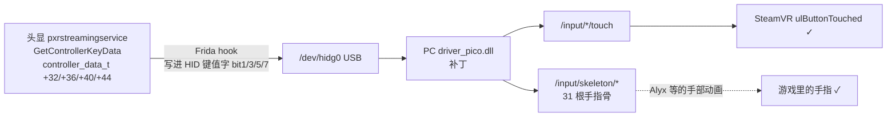

# PICO Neo 3 Pro · DP 直连手柄电容触摸修复

**简体中文** · [English](README.en.md)

> 用 DP 线串流时，手柄的电容触摸在 SteamVR 里不工作。这个工具让触摸恢复工作。

[介绍与教程视频（bilibili）](https://www.bilibili.com/video/BV1kjpA6BEwB)

## 你会遇到的现象

- 手柄的按键、摇杆和扳机都能用。
- 手指轻轻搭在 A/B/X/Y、扳机或摇杆顶上时，SteamVR 没有反应。
- 改用无线串流后，一切正常。

## 修好之后

A/B/X/Y、扳机、摇杆顶，六处触摸都能用。手指搭上去时，游戏里的手指也会动。

- 头显侧只改内存，重启后失效，每次开机后要重跑一次。
- PC 侧只改驱动自带的文件，可以一步还原。

## 本补丁另外修的东西

驱动补丁还修了几处问题，并补了一项 DP 版没有提供的数据。补丁只改驱动自带的文件，改前自动备份。细节见 [`docs/notes/04-driver.md`](docs/notes/04-driver.md)。

- **menu 键在 SteamVR 里没有反应。** 输入 profile 里 `/input/application_menu` 少一个斜杠，SteamVR 不认这条声明。
- **手柄模型的 `tip` 组件角度不对。** 只有 DP 这一份有这个问题。
- **驱动每次启动都报「读取 profile 失败」。** 原因是厂商没有提供头显 profile `pico_hmd_profile.json`。
- **游戏里的手指不动。** 补丁补出 `/pose/raw` 与 `/skeleton/*`，Alyx 这类游戏读取这两个路径来驱动手指动画。
- **游戏里的手柄位置偏约 4cm，还带一点倾斜。** 游戏启动时，串流程序给驱动发 `apprun` 消息，驱动收到后给手柄位姿加一段偏移。补丁让驱动忽略这条消息，游戏里的位姿于是与 SteamVR 菜单、待机时一致。这 4cm 也遮住了第二个问题：驱动把位姿报在跟踪环附近，虚拟手使用这个位姿时比握把低约 4cm，手臂也伸不直。补丁把位姿挪到握把点，同时把模型顶点反向补偿，于是手落在握把上，手柄模型仍和实物对齐。活动部件的支点也随顶点一起补偿，否则扣扳机、推摇杆时，它们会绕错的点转。摇杆的参数另有一处厂商错误，是按另一个轴向写的；补丁按模型几何，把摇杆的支点和转轴都改到摇杆自己的轴上。

## 适用条件

| 项       | 要求                                                                  |
| -------- | --------------------------------------------------------------------- |
| 头显     | **Neo 3 Pro 或 Pro Eye**。只有这系列有 DP 口。普通 Neo 3 没有 DP 口。 |
| 头显系统 | PUI **5.9.9**（build `202409100313`）                                 |
| PC 软件  | **中国版 1.2.11** 的 Business Streaming（DP 模式）                    |
| 连接方式 | **DP 直连**（不是无线串流）                                           |

- 只在 **Neo 3 Pro** 上实测过，**Pro Eye** 和海外版 **Neo 3 Link** 没有测试。
- 无线串流本来正常，不需要本项目。V2.x 没有 DP 模式。

## 快速开始

### 第 0 步 · 下载本项目

在 GitHub 页面点 **Code → Download ZIP**，然后解压。下文把解压出的文件夹称为「项目目录」。

PC 上不需要安装 adb，没有的话脚本会把它下载到 `src\windows\temp\`。这一步需要联网。

### 1. 给 PC 驱动打补丁（只需一次）

> 只需要 A/B/X/Y 的话可以跳过这一步，但跳过之后，「本补丁另外修的东西」也都没有了。

1. **退出 SteamVR、Business Streaming DP 和 Steam 客户端。** Steam 会占用驱动文件。
2. 双击 `src\windows\patch_driver.bat`。在 UAC 弹窗点 **「是」**。脚本会自动找驱动、备份、打补丁并复核；如果找不到驱动，它会问你路径，也可以用 `-Dll <DLL路径>` 参数。

### 2. 每次开机：注入头显

1. 在头显里打开 **设置 → 开发者选项**。**打开 adb**（「USB 调试」或「无线调试」）。该设备免授权，无线调试无需配对。
2. 连接头显：用 **USB 线**直连，或让头显和 PC 处在同一个网络，PC 开热点最简单。插了线时脚本就走线，不会自己改用无线。
3. 双击 `src\windows\pico_touch.bat`。脚本跑完后窗口会停住；要指定序列号就用 `-Serial <序列号>`。脚本会自动认头显、开 TCP 端口、拿临时 root、推送并注入，缺少的依赖也会自动下载。这一步需要联网。USB 直连时连接会中断几秒，这是正常现象。
4. 等待 `[+] 完成`，之后可以拔线、关窗口。注入在头显本地运行。

> **不想每次开机都接 PC？** 在头显上安装 **Termux** 并打开一次，然后运行头显补丁脚本。可以 PC 侧用 adb 安装，也可以在头显上安装 APK。之后每次开机，在 Termux 输入这条命令：
>
> ```shell
> dptouch
> ```
>
> 机制见 [`docs/notes/09-termux.md`](docs/notes/09-termux.md)。只想推文件、不提权也不注入？双击 `src\windows\push.bat`。

## 想把头显端「企业串流」换回 1.2.10？

本项目只在头显端 **1.2.10** 上验证过。头显连上 adb 后，双击 `src\windows\downgrade_streaming.bat` 换回 1.2.10。

PC 端也要换版本时，脚本会先问你要不要下载安装包（约 211 MB）。先在「应用和功能」里完全卸载新版，然后安装旧版，不要直接覆盖安装。

## 确认成功

打开 SteamVR → 设置 → 控制器 → **测试控制器**。手指依次搭在 A/B/X/Y、扳机、摇杆顶上，出现高亮就说明这个触摸点正常。

再看手柄：虚拟手必须正好在握把上，手柄模型必须和实物对齐。

最后扣扳机、推摇杆。扳机要绕自己的轴转，摇杆要绕自己的轴摆，帽不能滑开。

## 还原与卸载

| 改动                                                  | 怎么还原                                                                                                |
| ----------------------------------------------------- | ------------------------------------------------------------------------------------------------------- |
| PC 驱动                                               | 把同目录的 `driver_pico.dll.orig` 复制回 `driver_pico.dll`。或重装 DP 驱动。                            |
| profile、手柄模型、RVRPlugin.ini、头显 profile 的小修 | 把同目录的 `*.orig` 复制回同名文件。`pico_hmd_profile.json` 是脚本新建的，删掉即可。                    |
| 头显 root 与注入                                      | 重启后失效。也可以运行 `picohaxx -unroot`。                                                             |
| 推送到头显的文件                                      | 删除 `/data/local/tmp/{frida-inject,hook.js,start_touch.sh}`、`~/pico_touch` 和 `$PREFIX/bin/dptouch`。 |

## 常见问题

- **每次开机都要重跑吗？** 是。root 是临时的，它只改内存，不碰系统分区，重启后失效。
- **会永久损坏头显吗？** 头显侧只改内存，PC 侧只改驱动自带的文本文件和一个 DLL，脚本会自动备份。
- **注入后能拔线吗？** 能。注入在头显本地运行。
- **升级固件后还能用吗？** 不一定，新固件可能需要重新适配，见 [`docs/notes/06-root.md`](docs/notes/06-root.md)。

## 原理（可跳过）

触摸数据一直都在头显的控制器服务里，只是 DP 链路没人读它：头显 hook 把它写进 HID 报文，驱动补丁既把新增的位接到扳机 / 摇杆顶的 `/input/*/touch`，也用它算出 `/input/skeleton/*` 的 31 根手指骨（Alyx 这类游戏的手指动画读的就是后者）。



完整逆向记录见 [`docs/notes/`](docs/notes/)，不可行路线见 [`docs/notes/08-dead-ends.md`](docs/notes/08-dead-ends.md)。

## 致谢

- [`picohaxx`](https://github.com/264312431/picohaxx) —— Qualcomm Adreno/KGSL 提权。本项目用它作为 Neo 3 适配的基础。
- **DeepSeek V4.1 Flash**（大肥鱼妈妈！）—— 本项目逆向、调试与文档整理全程使用的模型。

## 许可

本仓库的代码与文档以 [WTFPL v2](LICENSE)（Do What The Fuck You Want To Public License）发布。本项目使用以下第三方组件：

- [`frida`](https://frida.re/) —— 注入框架。
- [`picohaxx`](https://github.com/264312431/picohaxx) —— Qualcomm Adreno/KGSL 提权（Neo 3 适配）。

各组件遵循其原始许可。本项目不分发 PICO 的驱动 DLL 或 APK。`src\windows\src\driver_patch\dp_skeleton_payload.bin` 里的骨架代码来自 PICO v2 串流驱动的 `driver_pico.dll`。这段代码的权利归 PICO，仅供个人设备修复使用。

## 免责声明

本项目涉及内核提权和修改厂商驱动二进制，仅供研究与个人设备修复使用，请自行评估风险。因使用本工具造成的设备损坏、数据丢失或保修失效，作者不承担责任。

**简体中文** · [English](README.en.md)
