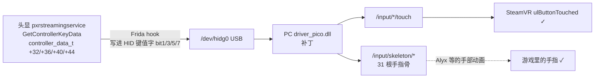

# PICO Neo 3 Pro · DP 直连手柄电容触摸修复

**简体中文** · [English](README.en.md)

> 用 DP 线串流时，手柄的「电容触摸」在 SteamVR 里失效；这个工具把它修回来。

[介绍&教程视频（bilibili）](https://www.bilibili.com/video/BV1kjpA6BEwB)

## 你会遇到的现象

- 手柄的**按键、摇杆、扳机都能用**；
- 但手指只是**轻轻搭在** A/B/X/Y、扳机或摇杆顶上时，SteamVR **毫无反应**；
- 换成无线串流，一切正常。

## 修好之后

A/B/X/Y、扳机、摇杆顶，六处触摸全部正常；游戏里的**手指**也会跟着动（搭上去就有动作）。

- 头显侧只改内存，**重启失效** ⇒ 每次开机重跑一次；
- PC 侧只在驱动自带的几个文件上打补丁，可一键还原。

## 本补丁另外修的东西

除触摸位之外，驱动补丁还顺手修了几处厂商遗留的问题，并补了一项 DP 版从没给过的数据（都只动驱动自带的文件、改前自动备份；细节见 [`docs/notes/04-driver.md`](docs/notes/04-driver.md)）：

- **menu 键在 SteamVR 里没反应** —— 输入 profile 里 `/input/application_menu` 少了个斜杠，SteamVR 不认这条声明；
- 手柄模型 `tip` 组件的角度笔误（只有 DP 这一份错）；
- 驱动**每次启动都报「读取 profile 失败」** —— 厂商漏发了头显 profile `pico_hmd_profile.json`；
- **游戏里的手指动画** —— 补出 `/pose/raw` 与 `/skeleton/*`，Alyx 这类游戏的手指才会动；
- **游戏里手柄位置偏 ≈4cm（还带一点歪）** —— 串流程序检测到游戏启动后会给驱动发 `apprun` 消息，驱动据此给游戏态的手柄位姿多加一段偏移；补丁让驱动忽略这条消息，游戏里与 SteamVR 菜单/待机时的手柄位置就一致了。
- **虚拟手不在手心、手臂伸不直** —— 驱动把手柄位姿报在跟踪环附近，虚拟手按同一个位姿抓握，就比握把低约 4cm；补丁把位姿挪到握把点、再把模型顶点反向补偿，手正好落在握把上，手柄模型仍和实物对齐。

## 适用条件

| 项       | 要求                                                                    |
| -------- | ----------------------------------------------------------------------- |
| 头显     | **Neo 3 Pro / Pro Eye**（DP 直连只有这系列才有；普通 Neo 3 没有 DP 口） |
| 头显系统 | PUI **5.9.9**（build `202409100313`）                                   |
| PC 软件  | **中国版 1.2.11** 的 Business Streaming（DP 模式）                      |
| 连接方式 | **DP 直连**（不是无线串流）                                             |

- 只在 **Neo 3 Pro** 上实测过；**Pro Eye、海外版 Neo 3 Link 未测试**。
- 无线串流本来就正常，**不需要**本项目；V2.x 根本没有 DP 模式。

## 快速开始

### 第 0 步 · 下载本项目

在 GitHub 页面点 **Code → Download ZIP**，解压；下面把解压出的文件夹统称「项目目录」。

PC 上装不装 adb 都行 —— 没装的话脚本会自己下载到 `src\windows\temp\`（需要联网）。

### 1. 给 PC 驱动打补丁（一次性）

> 只想恢复 A/B/X/Y、不需要扳机与摇杆顶的触摸？这一步可以跳过 —— 但「本补丁另外修的东西」也就没了。

1. **完全退出** SteamVR、Business Streaming DP 和 **Steam 客户端**（Steam 会占着驱动文件）；
2. 双击 `src\windows\patch_driver.bat`，在 UAC 弹窗点「是」。
   脚本自己找驱动、先备份再改、改完复核；找不到就直接问你要路径（或加参数 `-Dll <DLL路径>`）。

### 2. 头显每次开机：注入头显

1. 在头显 **设置 → 开发者选项** 里**打开 adb**（「USB 调试」或「无线调试」；该设备免授权，无线无需配对）；
2. 连接头显：**USB 线**直连，或让头显和 PC 连同一网络（PC 开热点最省事）。插了线就用线，脚本不会自己换成无线；
3. 双击 `src\windows\pico_touch.bat`（跑完窗口会停住；指定序列号用 `-Serial <序列号>`）。
   脚本自动完成：认头显 → 开 TCP 端口 → 拿临时 root → 推送 → 注入；缺的依赖会自动下载（需要联网）。
   USB 直连时中途会短断几秒（要重开一次 TCP 端口），属正常；
4. 看到 `[+] 完成` 即可，之后能拔线、关窗口（注入跑在头显本地）。

> **不想每次接 PC？** 头显上装 **Termux** 并打开一次后再跑头显补丁脚本（PC 侧 `adb` 安装，或头显侧载 APK），之后每次开机在 Termux 敲一行回车即可：
>
> ```shell
> dptouch
> ```
>
> 机制见 [`docs/notes/09-termux.md`](docs/notes/09-termux.md)。只想推文件、不提权也不注入？双击 `src\windows\push.bat`。

## 头显端「企业串流」想换回 1.2.10？

本项目只在头显端 **1.2.10** 上验证过。头显连上 adb 后双击 `src\windows\downgrade_streaming.bat` 把它换回来。

PC 端要一起换版本时脚本会先问你要不要下安装包（约 211 MB）：**先在「应用和功能」里完全卸载新版，再装它**，别直接覆盖。

## 确认成功

SteamVR → 设置 → 控制器 → **测试控制器**：手指依次搭在 A/B/X/Y、扳机、摇杆顶上，出现高亮即为成功。

顺便看一眼手柄：虚拟手应该正好握在握把上，手柄模型和实物对齐。

## 还原 / 卸载

| 改动                                                  | 怎么还原                                                                                            |
| ----------------------------------------------------- | --------------------------------------------------------------------------------------------------- |
| PC 驱动                                               | 把同目录的 `driver_pico.dll.orig` 复制回 `driver_pico.dll`；或重装 DP 驱动                          |
| profile、手柄模型、RVRPlugin.ini、头显 profile 的小修 | 把同目录的 `*.orig` 复制回同名文件（`pico_hmd_profile.json` 是本脚本新建的，删掉即可）              |
| 头显 root + 注入                                      | 重启即失效；也可 `picohaxx -unroot`                                                                 |
| 推送到头显的文件                                      | 删除 `/data/local/tmp/{frida-inject,hook.js,start_touch.sh}`、`~/pico_touch`、`$PREFIX/bin/dptouch` |

## 常见问题

- **每次开机都要重跑吗？** 是。root 是临时的（只改内存、不碰系统分区），重启失效。
- **有变砖风险吗？** 头显侧只改内存；PC 侧只改驱动自带的文本文件与一个 DLL，且自动备份。
- **注入完能拔线吗？** 能。注入跑在头显本地，与 PC 无关。
- **升级固件后还能用吗？** 不一定，需要重新适配，见 [`docs/notes/06-root.md`](docs/notes/06-root.md)。

## 原理（可跳过）

触摸数据一直都在头显的控制器服务里，只是 DP 链路没人读它：头显 hook 把它写进 HID 报文，驱动补丁既把新增的位接到扳机 / 摇杆顶的 `/input/*/touch`，也用它算出 `/input/skeleton/*` 的 31 根手指骨（Alyx 这类游戏的手指动画读的就是后者）。



完整逆向记录见 [`docs/notes/`](docs/notes/)，不可行路线见 [`docs/notes/08-dead-ends.md`](docs/notes/08-dead-ends.md)。

## 致谢

- [`picohaxx`](https://github.com/264312431/picohaxx) —— Qualcomm Adreno/KGSL 提权，本项目 Neo 3 适配的基础
- **DeepSeek V4.1 Flash**（大肥鱼妈妈！） —— 本项目逆向、调试与文档整理全程使用的模型

## 许可

本仓库代码与文档以 [WTFPL v2](LICENSE)（Do What The Fuck You Want To Public License）发布。其中涉及的第三方组件：

- [`frida`](https://frida.re/) —— 注入框架
- [`picohaxx`](https://github.com/264312431/picohaxx) —— Qualcomm Adreno/KGSL 提权（Neo 3 适配）

各自遵循其原始许可。本项目不分发 PICO 的驱动 DLL / APK，但 `src\windows\src\driver_patch\dp_skeleton_payload.bin` 里的骨架代码是从 PICO v2 串流驱动的 `driver_pico.dll` 里整段提取的 —— 权利仍归 PICO，仅供个人设备修复使用。

## 免责声明

本项目涉及**内核提权**与**修改厂商驱动二进制**，仅供研究与个人设备修复使用。请自行评估风险；因使用本工具导致的设备损坏、数据丢失或保修失效，作者不承担责任。

**简体中文** · [English](README.en.md)
